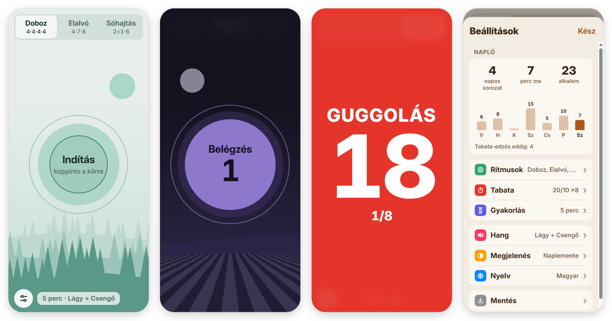

# RelaxRing – Légző körök

Légzőgyakorló és edzés-időzítő telefonra. A lélegző körök mutatják, mikor szívd be, tartsd bent és fújd ki a levegőt. Halk hang, rezgés és kérésre hangos vezetés segít, így csukott szemmel is követhető. Appként telepíthető, internet nélkül is működik, és nem küld adatot sehova.

**▶ Megnyitás: https://vmynick.github.io/relaxring/**

*Főképernyő háttérképpel · légzés közben (sötét mód) · Tabata edzés · Beállítások*

## Funkciók

### Légzés

| Ritmus | Ütem (mp) | Jellemző |
|---|---|---|
| Doboz | 4 be · 4 tart · 4 ki · 4 tart | négy egyforma szakasz |
| Elalvó | 4 be · 7 tart · 8 ki | hosszú tartás és kilégzés, lefekvés előtt |
| Nyugtató | 4 be · 6 ki | a kilégzés hosszabb a belégzésnél |
| Sóhajtás | 2 be + 1 rászívás · 6 ki | rövid, 1–3 perces stresszoldáshoz |
| Koherens | 5 be · 5 ki | percenként 6 légzés |
| Lazító | 4 be · 2 tart · 6 ki | rövid tartás, hosszú kilégzés |
| Lassuló | 4 be · 4→8 ki | a kilégzés a gyakorlás végére 8 mp-re nyúlik |
| Saját | állítható | be és ki 2–12 mp, tartások 0–12 mp |

- A főképernyőn a Beállításokban kiválasztott 3 ritmus látszik. A körre koppintva indul és áll meg a gyakorlás.
- Időtartam 1–30 perc. A gyakorlás a ritmus egy teljes körének végén áll meg.
- **Fókusz mód:** gyakorlás közben a körökön kívül minden elhalványul, egy koppintás visszahozza.
- **Alvás mód:** a képernyő lassan elsötétül, a végén nincs csengés, és a természethang lassan elhalkul.
- **Hangok:** 4 légzőhang (Lágy, Óceán, Pad, Tál) és 5 csengés (Csengő, Tál, Fa, Csepp, Piezo). A légzés alá természethang is szólhat (eső, patak, tűz, szél). Mindet a telefon állítja elő, nincs letöltendő hangfájl.
- **Hangos vezetés:** a telefon felolvasóhangja mondja be a szakaszokat. Ha nincs hang a választott nyelven, az app jelzi.

### Edzés (Tabata)

- **Előbeállítások:** Tabata 20/10 mp × 8, HIIT 40/20 mp × 8, EMOM 1 perc × 10.
- **Beállítások:**
  - A főképernyőn: munka (5–90 mp), pihenő (0–90 mp), körök (1–30), blokkok (1–5).
  - A Beállításokban: felkészülés (0–30 mp) és a blokkok közti pihenő (10–180 mp).
- **Messziről is látható kijelzés:** edzés közben az egész képernyő a szakasz színére vált. Munkánál piros, pihenőnél zöld, felkészüléskor sárga, óriási számokkal.
- **Hangos, külön állítható jelzés:** 3-2-1 csipogás minden váltás előtt, más hang a munka és a pihenő elején, és erősebb rezgés.
- **Gyakorlatlista:** munka közben a gyakorlat neve látszik, pihenőnél a következő. A hangos vezetés be is mondja.

### Napló és mentés

- A napló mutatja a napos sorozatot, a mai perceket, az alkalmak számát és az elmúlt 7 nap oszlopdiagramját. A Tabata-edzések külön számítanak.
- A napló és a beállítások JSON-fájlba menthetők, és visszatölthetők, például új telefonon vagy újratelepítés után. Visszatöltéskor a napló napokra bontva összefésülődik.

### Megjelenés

- 6 színtéma: Erdő, Tenger, Levendula, Naplemente, Rózsa, Kő. A világos vagy sötét mód a telefon beállítását követi.
- Témánként háttérkép: a téma színeiből rajzolt nyugodt táj, kikapcsolható.
- Nyelvek: magyar, English, Deutsch. Első indításkor a telefon nyelvét követi.

## Telepítés

- **Android, Chrome:** nyisd meg a címet, majd ⋮ menü → *Alkalmazás telepítése*, vagy koppints az appban felugró „Telepítés” gombra.
- **iPhone, iPad, Safari:** Megosztás → *Főképernyőhöz adás*.
- **Számítógépen, Chrome vagy Edge:** a címsor végén lévő telepítés ikonnal.

A telepített app:
- internet nélkül is elindul;
- Androidon teljes képernyős, az állapotsor és a gombsor a képernyő széléről húzva jön elő;
- gyakorlás közben ébren tartja a képernyőt;
- ikonja hosszan nyomva gyorsindítót kínál: Elalvó, Doboz, Nyugtató, Koherens.

Ha új verzió jelenik meg, az app kiírja: „Új verzió érhető el” → *Frissítés*.

## Kezelés

| Mit | Hogyan |
|---|---|
| Indítás, leállítás | koppints a körre |
| Ritmus váltása | felső gombsor |
| Beállítások | bal alsó gomb |
| Kilépés (telepített app) | jobb alsó **X**, kétszer koppintva |
| Gombok gyakorlás közben | koppints bárhova a körön kívül |
| Vissza a Beállításokban | **‹** gomb vagy a telefon vissza mozdulata |

## Adatvédelem

- Nincs fiók, nincs regisztráció, nincs analitika és nincs süti.
- A beállítások és a napló a telefon böngészőjének helyi tárolójában maradnak.
- Az app fájljait a GitHub Pages szolgálja ki. Ezen kívül az app nem küld kérést sehova, a betűtípus is helyben van.
- A telefon törölheti a helyi tárolót, például ha törlöd a böngészőadatokat. Ezért érdemes időnként fájlba menteni (Beállítások → Mentés).

## Ismert korlátok

- **iPhone:**
  - A Safari nem támogatja a rezgést.
  - A teljes képernyőre váltás és a vissza mozdulat kezelése csak Androidon működik.
- **Hangos vezetés:** a telefonra telepített felolvasóhangtól függ.
- **Hangerő:** a hangok és a jelzések hangereje a telefon médiahangerejétől is függ.
- **Képernyő:** gyakorlás közben ne kapcsold ki. Az app ébren tartja, de kikapcsolt képernyőnél a böngésző szüneteltetheti az időzítést.

## Fejlesztés

Az app egyetlen HTML-fájl (HTML, CSS és JavaScript), nincs keretrendszer, és nem kell lefordítani. A hangokat a Web Audio API állítja elő, a háttérképeket SVG-ként rajzolja.

| Fájl | Szerepe |
|---|---|
| [index.html](index.html) | az egész app: felület, időzítés, hangok, nyelvi szótár |
| [sw.js](sw.js) | service worker: offline gyorsítótár és frissítés |
| [manifest.json](manifest.json) | telepítési adatok, ikonok, gyorsindítók |
| [fonts.css](fonts.css), [fonts/](fonts) | Inter betűtípus |
| `*.png` | ikonok |
| [setup.html](setup.html) | csak a korábbi otthoni szerveres változathoz |
| [docs/](docs) | a README képei, nem kerülnek ki az oldalra |
| [.github/workflows/pages.yml](.github/workflows/pages.yml) | közzététel |

**Helyi futtatás:** az `app` mappában indíts egy egyszerű webszervert, például `python -m http.server 8000`, majd nyisd meg a http://localhost:8000 címet. A service worker localhoston is működik.

**Közzététel:** minden `main`-re küldött módosítás után a GitHub Actions kb. 1 perc alatt közzéteszi az oldalt. Közben két dolgot csinál:
- új verziószámot ír a `sw.js`-be, ezért jelzi a telepített app a frissítést;
- a manifestben az app azonosítóját a `/relaxring/` útvonalra állítja.

**Bővítés:**
- **Új nyelv:** a `T` szótárba kell egy új blokk, ugyanazokkal a kulcsokkal, mint a meglévők.
- **Új ritmus:** az `R` táblába és az `RIDS` listába kell felvenni, és minden nyelvhez kell egy `r_<azonosító>` felirat.

## Licenc

A betűtípus az [Inter](https://rsms.me/inter/) a SIL Open Font License 1.1 alatt ([fonts/OFL-Inter.txt](fonts/OFL-Inter.txt)). Apple-eszközökön a rendszer saját betűje (SF Pro) látszik.

---

### English

RelaxRing is a breathing-exercise and interval-timer web app for phones, at **https://vmynick.github.io/relaxring/**. Breathing circles show when to inhale, hold and exhale, with soft sound, vibration and optional voice guidance. It comes with eight rhythms, including box, 4-7-8, physiological sigh, coherent and custom.

The Tabata/HIIT/EMOM timer uses a full-screen color display that is readable from a distance, loud adjustable beeps and an exercise list. The app also has a journal with streaks, nature sounds, sleep mode, color themes with background scenes, and file backup.

It installs as an app, works offline and keeps all data on the device. It is available in Hungarian, English and German.
