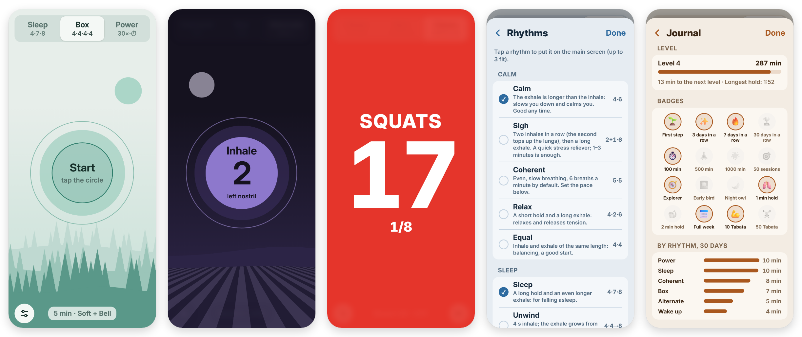

# RelaxRing – Breathing Circles

A breathing-exercise app and interval timer for your phone. Breathing circles show when to inhale, hold and exhale. Soft sound, vibration and optional voice guidance let you follow along with your eyes closed. It installs as an app, works offline and does not send any data anywhere.

**▶ Open the app: https://vmynick.github.io/relaxring/**

*Main screen with a background scene · breathing session (dark mode) · Tabata workout · Settings*

## Features

### Breathing

| Rhythm | Pattern (seconds) | What it is |
|---|---|---|
| Box | 4 in · 4 hold · 4 out · 4 hold | four equal parts |
| Sleep | 4 in · 7 hold · 8 out | the 4-7-8 pattern, long hold and exhale, for bedtime |
| Calm | 4 in · 6 out | exhale longer than inhale |
| Sigh | 2 in + 1 top-up · 6 out | the physiological sigh, a quick 1–3 minute reset |
| Coherent | 5 in · 5 out | six breaths a minute |
| Relax | 4 in · 2 hold · 6 out | short hold, long exhale |
| Unwind | 4 in · 4→8 out | the exhale lengthens to 8 s by the end of the session |
| Custom | your choice | inhale and exhale 2–12 s, holds 0–12 s |

- The main screen shows the 3 rhythms you pick in Settings. Tap the circle to start or stop.
- Sessions last 1–30 minutes and end after the current breath cycle.
- **Focus mode:** while you breathe, everything except the circles fades. Tap once to bring the controls back.
- **Sleep mode:** the screen slowly goes dark, there is no chime at the end and the nature sound fades out slowly.
- **Sounds:**
  - 4 breathing sounds: Soft, Ocean, Pad, Bowl.
  - 5 chimes: Bell, Bowl, Wood, Drop, Piezo.
  - Optional nature sound under the session: rain, stream, fire or wind.
  
  The phone synthesizes all of them, so there are no audio files to download.
- **Voice guidance:** the phone's text-to-speech voice reads out each phase. If no voice is installed for the selected language, the app tells you.
- **Screen off:** sessions keep running with the screen locked. The lock screen shows "RelaxRing – Inhale" with pause, resume and stop, and a headset button pauses too. An incoming call pauses the session. Some sound must be on for this to work.

### Workouts (Tabata)

- **Presets:** Tabata 20/10 s × 8, HIIT 40/20 s × 8, EMOM 1 min × 10.
- **Adjustable:**
  - On the main screen: work (5–90 s), rest (0–90 s), rounds (1–30) and sets (1–5).
  - In Settings: get-ready time (0–30 s) and rest between sets (10–180 s).
- **Readable from across the room:** during a workout the whole screen takes the phase color, with a huge countdown:
  - red for work,
  - green for rest,
  - yellow while getting ready.
- **Loud signal with its own volume:**
  - 3-2-1 beeps before every change,
  - a different tone at the start of work and of rest,
  - stronger vibration.
- **Exercise list:** the current exercise shows during work and the next one during rest. Voice guidance reads them out.
- **Safe controls:** tapping the number pauses the workout and holding it stops, so a sweaty touch cannot end it by mistake. ⏭ jumps to the next part, also from the lock screen.
- **Landscape:** turn the phone sideways and the countdown fills the screen next to the exercise name.

### Journal and backup

- The journal shows your day streak, today's minutes and the number of sessions.
- **Daily goal:** 2–30 minutes, with a progress bar and the number of days this week you reached it.
- **Charts:** a 7-day bar chart with a line for the goal, and a monthly calendar for the past year. Days that met the goal are filled, days with practice below the goal are shaded.
- Tabata workouts are counted separately.
- You can save the journal and all settings to a JSON file and restore them, for example on a new phone or after a reinstall. When you restore, the app merges the journal day by day.

### Appearance

- 6 color themes: Forest, Sea, Lavender, Sunset, Rose, Stone. Light or dark mode follows the phone setting.
- An optional background scene for each theme: a calm landscape drawn in the theme's colors.
- Languages: English, Hungarian, German, Spanish, French, Italian, Polish. On first launch the app uses the phone's language.
- **Share the app** in Settings opens the phone's share sheet, or copies the link where there is none.

### Help

- **Help & about** in Settings has short instructions, the list of changes, the privacy note and the version.
- On first launch the app offers the help page.
- After an update it shows once what is new.

## Install

- **Android, Chrome:** open the link, then ⋮ menu → *Install app*, or tap the "Install" button the app shows.
- **iPhone, iPad, Safari:** Share → *Add to Home Screen*.
- **Desktop, Chrome or Edge:** use the install icon at the end of the address bar.

The installed app:
- starts without an internet connection;
- runs full screen on Android, where you swipe from the edge to show the status and navigation bars;
- keeps the screen awake during a session;
- offers quick starts when you long-press its icon: Sleep 4-7-8, Box, Calm, Coherent.

When a new version is published, the app shows "A new version is available" → *Update*.

## Controls

| Action | How |
|---|---|
| Start or stop | tap the circle |
| Tabata: pause or stop | tap the number to pause, hold it to stop |
| Tabata: next part | ⏭ button, or next on the lock screen or headset |
| Pause or resume | lock screen controls or headset button; while paused, tap the circle to continue |
| Switch rhythm | buttons at the top |
| Settings | bottom-left button |
| Exit (installed app) | bottom-right **X**, tap twice |
| Controls during a session | tap anywhere outside the circle |
| Back in Settings | **‹** button or the phone's back gesture |

## Privacy

- There is no account, no sign-up, no analytics and no cookies.
- Settings and the journal stay in the browser's local storage on your phone.
- GitHub Pages serves the app files. Beyond that the app makes no requests, and the font is bundled.
- Clearing the browser data deletes the local storage, so save a backup from time to time (Settings → Backup).

## Known limitations

- **iPhone:**
  - Safari does not support vibration.
  - Full screen and the back-gesture handling only work on Android.
- **Voice guidance** depends on the text-to-speech voices installed on the phone.
- **Volume:** the phone's media volume also limits the sounds and signals.
- **Screen off:** this needs some sound on (breathing sound, chime or nature sound). If every sound is off, the browser may slow down or pause the timer while the screen is locked. Some phones' battery savers can also stop the app in the background.

## Development

The app is a single HTML file with HTML, CSS and JavaScript. It uses no framework and has no build step. Sounds are synthesized with the Web Audio API, and the background scenes are drawn as SVG.

| File | Purpose |
|---|---|
| [index.html](index.html) | the whole app: UI, timing, sounds, translations |
| [sw.js](sw.js) | service worker: offline cache and update notice |
| [manifest.json](manifest.json) | install data, icons, shortcuts |
| [fonts.css](fonts.css), [fonts/](fonts) | the Inter font |
| `*.png` | icons |
| [setup.html](setup.html) | only for the earlier self-hosted home-server version |
| [docs/](docs) | README images, not published to the site |
| [tests/](tests), [playwright.config.mjs](playwright.config.mjs), [package.json](package.json) | browser tests; only needed for development |
| [.github/workflows/pages.yml](.github/workflows/pages.yml) | tests and publishing |

**Run locally:** start any static web server in this folder, for example `python -m http.server 8000`, and open http://localhost:8000. The service worker also works on localhost.

**Tests:** run `npm install` once, then `npm test`. Playwright runs the tests in headless Chromium against a small built-in web server. They cover:
- loading in every language;
- a full breathing session and the journal;
- pause and resume with the lock-screen data;
- catching up after the browser was throttled;
- the rhythm picker;
- Tabata and EMOM, pause, skip and long-press stop;
- the landscape layout;
- sharing the app;
- that every language has the same texts;
- settings navigation;
- backup and restore;
- shortcuts;
- offline start;
- the daily goal and calendar;
- the "what's new" notice.

**Publishing:** every push to `main` runs the tests first. The site is published only if they all pass, about 2–3 minutes in total. The workflow also:
- writes a new version into `sw.js`, which is how installed apps notice an update;
- sets the app id in the manifest to the `/relaxring/` path.

**Releasing:** add an entry at the top of the `NEWS` list in `index.html`. Its version becomes the app version, and installed apps show the "what's new" notice once.

**Extending:**
- **New language:** add a block to the `T` dictionary in `index.html` with the same keys as the existing ones.
- **New rhythm:** add it to the `R` table and the `RIDS` list, and add an `r_<id>` label in every language.

## License

The code is under the [MIT License](LICENSE).

The font is [Inter](https://rsms.me/inter/), under the SIL Open Font License 1.1 ([fonts/OFL-Inter.txt](fonts/OFL-Inter.txt)). On Apple devices the system font (SF Pro) is used instead.
